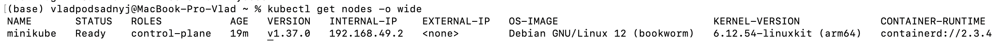
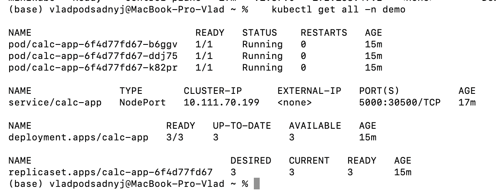
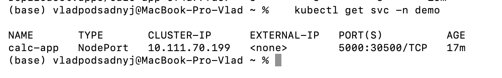
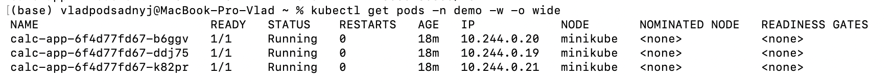
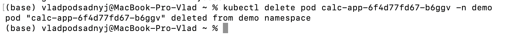
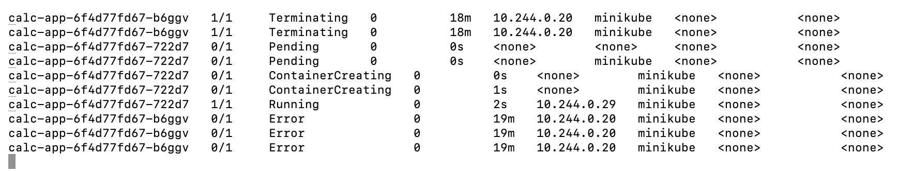

# Отчёт по лабораторной работе № 1
## «Развёртывание приложения в Kubernetes»

**Студент:** Подсадный Владислав Андреевич

**Группа:** не указана

**Дата выполнения:** 15 ноября 2026 года

## Задание 1. Кластер

Команда `kubectl get nodes -o wide` показала один узел `minikube` в состоянии `Ready`; Kubernetes v1.37.0, среда контейнеров containerd 2.3.4. Узел сообщает 8 CPU и 6 067 048 Ki памяти. Проверки MemoryPressure, DiskPressure и PIDPressure имеют значение False, Ready — True. Это локальный одноузловой кластер minikube: одного узла достаточно для учебного эксперимента; отказоустойчивость нескольких узлов он не демонстрирует.

Список системных подов и полный вывод команд сохранены в [01-cluster.txt](../evidence/01-cluster.txt); среди них API server, etcd, scheduler и controller manager.

## Задание 2. Pod

Под запущен командой `kubectl run calc-pod --image=calc-app:v1 --image-pull-policy=Never --port=5000`. Он перешёл в состояние `1/1 Running`, IP — `10.244.0.3`. Запрос `/calc?op=mul&a=6&b=7` вернул `{"result":42.0}`, а `/health` — `{"status":"ok"}`. После удаления отдельный Pod не восстановился, потому что у него не было контроллера, который поддерживал бы нужное количество копий. Диагностика и ответы: [02-pod.txt](../evidence/02-pod.txt).

## Задание 3. Deployment

Deployment `calc-app` был готов `3/3`; создан ReplicaSet `calc-app-6f4d77fd67` и три пода. Имя пода включает имя Deployment, хеш шаблона ReplicaSet и уникальный суффикс пода. После обновления образа с `calc-app:v1` на `calc-app:v2` история содержала ревизии 1 и 2; выполнен успешный откат к `v1`. ReplicaSet поддерживает количество подов, а Deployment управляет наборами ReplicaSet и позволяет обновлять и откатывать версии. Выводы: [03-deployment.txt](../evidence/03-deployment.txt).

## Задание 4. Service

Service `calc-app` имеет тип NodePort, ClusterIP `10.111.70.199`, порт `5000:30500/TCP`. Первоначально в Endpoints были `10.244.0.6:5000`, `10.244.0.4:5000`, `10.244.0.5:5000`. Из тестового пода запрос по DNS-имени `calc-app.demo` вернул `{"result":5.0}`. CoreDNS разрешает имя сервиса в его ClusterIP, а сервис выбирает подходящие готовые поды по метке `app=calc-app`, используя EndpointSlice. Запросы через сервис из кластера попали на разные поды, что видно в [логах](../evidence/04-service-balance.txt). Остальные результаты: [04-service.txt](../evidence/04-service.txt).

## Задание 5. Scaling

При увеличении числа реплик Deployment стал `5/5`, а в Endpoints появились пять адресов: `10.244.0.19`, `10.244.0.20`, `10.244.0.21`, `10.244.0.27`, `10.244.0.28` (зафиксированы повторной проверкой после готовности всех пяти); затем проверены `2/2` и возврат к `3/3`. `kubectl scale` меняет число реплик командой непосредственно в кластере; правка YAML с `kubectl apply` задаёт состояние в манифесте. Для production предпочтительнее хранить желаемую конфигурацию в системе контроля версий и применять её через согласованный процесс: состояние можно проверить и воспроизвести. Выводы: [05-scale.txt](../evidence/05-scale.txt).

## Задание 6. Самовосстановление

На дополнительном наблюдении был удалён Pod `calc-app-6f4d77fd67-b6ggv` с IP `10.244.0.20`. Созданный ему на замену Pod `calc-app-6f4d77fd67-722d7` прошёл состояния Pending и ContainerCreating и перешёл в Running с IP `10.244.0.29`.

Удалён Pod `calc-app-6f4d77fd67-9xthr` с IP `10.244.0.11`; ReplicaSet создал Pod `calc-app-6f4d77fd67-n6gwf`, который перешёл в `Running` с IP `10.244.0.17`. Наблюдение `kubectl get pods -w` сохранено в [06-watch.txt](../evidence/06-watch.txt). У `crash-demo` число перезапусков выросло до 2, а в событиях появился `BackOff`: это увеличивающаяся пауза перед очередным перезапуском падающего контейнера. Данные: [06-crash.txt](../evidence/06-crash.txt).

Pod восстанавливает ReplicaSet; контейнер внутри Pod перезапускает kubelet согласно restartPolicy. После удаления Deployment его поды завершались и новые не создавались: соответствующее желаемое состояние больше не существовало. Затем Deployment был развёрнут повторно. Выводы: [06-before-after.txt](../evidence/06-before-after.txt).

## Задание 7. Разбор

Письменные ответы на шесть вопросов и описание цепочки от манифеста до ответа приложения: [ответы-к-заданию-7.md](../evidence/ответы-к-заданию-7.md). **Самооценка по чек-листу:** ___ из 12 команд без подсказок.

## Вывод

Desired state — конфигурация, которую пользователь задаёт Kubernetes. Контроллеры сравнивают её с фактическим состоянием и стремятся устранить расхождения. Kubernetes называют декларативной системой, поскольку манифест описывает желаемый результат, а не последовательность всех действий для его достижения.

Скриншоты терминала и текстовые результаты команд находятся в папке `evidence/`.
